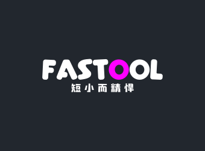

<p align="center" style="margin:10px 0;">
    
</p>

<p align="center">
    
    
    
    
    
    
</p>

# Fastool

一个短小精悍的现代 JavaScript 工具库。**零运行时依赖**，全部功能由原生 JS 实现，使用 TypeScript 编写，同时提供 ESM / CJS / UMD 三种格式，可直接作为其他项目的标准依赖。

## 特性

- **零依赖** —— 所有实现均为原生 JS，不引入任何第三方运行时库
- **类型安全** —— TypeScript 编写，随包发布聚合后的 `.d.ts`
- **多格式** —— ESM（`.mjs`）/ CJS（`.cjs`）/ UMD（`.umd.min.js`）
- **可 tree-shaking** —— 声明 `sideEffects: false`，按需引入不打包无用代码
- **SSR 安全** —— 所有涉及 `window` / `document` / `navigator` 的函数都做了服务端兜底，不会在 Node 下抛错
- **265 个导出** —— 主入口 236 + 插件入口 5 + polyfill 入口 24，覆盖数组、对象、字符串、数字、时间、URL、函数、存储、设备等 18 个分类

## 安装

```bash
# pnpm（推荐）
pnpm add fastool

# npm
npm install fastool

# yarn
yarn add fastool
```

CDN 直接引入（UMD，全局变量 `fastool`）：

```html
<script src="https://cdn.jsdelivr.net/npm/fastool@latest"></script>
<script>
  fastool.camelCase('hello world'); // 'helloWorld'
</script>
```

## 使用

```ts
// 按需引入（推荐，配合 tree-shaking 体积最小）
import { chunk, deepClone, formatDate } from 'fastool';

// 全量引入
import * as fastool from 'fastool';

// CommonJS
const { chunk } = require('fastool');
```

### 三个入口

| 入口 | 说明 |
| --- | --- |
| `fastool` | **主入口**，零依赖、纯原生实现，绝大多数场景用它 |
| `fastool/plugins` | 插件入口，内部会从 CDN 动态加载 dayjs / clipboard 等第三方库。**需要保持零外部依赖时不要引入** |
| `fastool/polyfill` | 原型补丁入口，调用后才会修改原型，不引入副作用 |

```ts
import { chunk } from 'fastool';
import { dayJs } from 'fastool/plugins';
import { polyfillStringIncludes } from 'fastool/polyfill';
```

## API

### array（29）

`chunk` `compact` `countBy` `difference` `drop` `flatten` `flattenDeep` `groupBy` `head` `intersection` `keyBy` `last` `maxBy` `minBy` `move` `partition` `range` `sample` `sampleSize` `shuffle` `sortBy` `sum` `sumBy` `take` `union` `uniq` `uniqBy` `unzip` `zip`

```ts
chunk([1, 2, 3, 4, 5], 2);            // [[1,2],[3,4],[5]]
uniqBy([{ id: 1 }, { id: 1 }], 'id'); // [{ id: 1 }]
groupBy(list, 'type');                // { a: [...], b: [...] }
sortBy(users, 'age', 'desc');          // 稳定排序，支持 asc / desc
```

### is（23）

`isArray` `isBoolean` `isDate` `isDef` `isElement` `isEmpty` `isEmptyObject` `isError` `isFunction` `isInteger` `isJSON` `isMap` `isNil` `isNumber` `isNumeric` `isObject` `isPlainObject` `isPrimitive` `isPromise` `isRegExp` `isSet` `isString` `isSymbol`

```ts
isPlainObject({});      // true
isPlainObject([]);      // false
isDate(new Date('x'));  // false（Invalid Date 不算日期）
isEmpty(new Map());     // true
```

### objects（13）

`deepEqual` `fromPairs` `get` `has` `invert` `mapKeys` `mapValues` `omit` `omitBy` `pick` `pickBy` `set` `toPairs`

```ts
get({ a: { b: [{ c: 42 }] } }, 'a.b[0].c'); // 42
set({}, 'a.b[0].c', 1);                      // { a: { b: [{ c: 1 }] } }
deepEqual(new Map([['a', 1]]), new Map([['a', 1]])); // true（支持 Date/RegExp/Map/Set）
```

### string（20）

`byteLength` `camelCase` `capitalize` `count` `escapeRegExp` `firstUpperCase` `getCamelCase` `getEscapeString` `getKebabCase` `getUnEscapeString` `kebabCase` `mask` `nanoid` `pascalCase` `randomString` `reverse` `snakeCase` `telEncrypt` `template` `trim` `truncate`

```ts
camelCase('get user info');  // 'getUserInfo'
snakeCase('getUserInfo');    // 'get_user_info'
mask('13812345678', 3, 4);   // '138****5678'
byteLength('你好');           // 6（UTF-8 字节数）
template('{{name}}：{{age}}', { name: '小明', age: 18 });
```

### number（13）

`bytesToSize` `clamp` `digitUppercase` `gcd` `getDistance` `inRange` `intToChinese` `lcm` `lerp` `percentage` `round` `sumAverage` `toThousands`

```ts
round(1.005, 2);         // 1.01（原生 toFixed 会得到 1.00）
toThousands(1234567.89); // '1,234,567.89'
digitUppercase(123.45);  // '壹佰贰拾叁元肆角伍分'
```

### time（21）

`addDays` `diffDays` `endOfDay` `formatDate` `formatDuration` `formatPassTime` `formatRemainTime` `getAge` `getDaysByMonth` `getNowTime` `getTimestamp` `getWeekday` `isLeapYear` `isSameDay` `isToday` `isTomorrow` `isWeekend` `isYesterday` `parseDate` `startOfDay` `timeLeft`

```ts
formatDate('YYYY-MM-DD HH:mm:ss', '2024-05-01 09:08:07'); // '2024-05-01 09:08:07'
formatDate('YYYY年第Q季度 WW', '2024-05-01');              // '2024年第2季度 星期三'
parseDate('2024-01-01 12:00:00');  // 兼容 iOS Safari 不支持的横杠格式
formatDuration(93784000);          // '1天 2小时 3分钟 4秒'
```

### url（11）

`delUrlParams` `getBaseUrl` `getQueryParam` `getUrlDomain` `getUrlParams` `isAbsoluteUrl` `joinUrl` `paramsJoinUrl` `setUrlParams` `stringifyQuery`

```ts
getUrlParams('https://a.com?x=1&y=hi');       // { x: 1, y: 'hi' }
setUrlParams('id', 3, 'https://a.com?x=1');   // 'https://a.com?x=1&id=3'
delUrlParams('x', 'https://a.com?x=1&y=2');   // 'https://a.com?y=2'
joinUrl('https://a.com/', '/api/', '/list');  // 'https://a.com/api/list'
```

### function（25）

`compose` `curry` `debounce` `deepClone` `defer` `fetchUtil` `getTypeOf` `identity` `isAsyncFunction` `memoize` `mergeObject` `negate` `noop` `observeDef` `observeProxy` `once` `partial` `pipe` `rafThrottle` `sleep` `throttle` `times` `withTimeout`

```ts
const search = debounce(fn, 300);   // 带 .cancel()
const onScroll = throttle(fn, 100); // 支持 leading / trailing
const clone = deepClone(cyclicObj); // 支持 Date/RegExp/Map/Set 与循环引用
const ok = await retry(task, 3, 100);
await withTimeout(fetch(url), 5000);
```

### storage（15）

`createStorage` `setLocalStorage` `getLocalStorage` `delLocalStorage` `clearLocalStorage` `setSessionStorage` `getSessionStorage` `delSessionStorage` `clearSessionStorage` `setCookie` `getCookie` `getAllCookies` `hasCookie` `deleteCookie`

```ts
setLocalStorage('user', { name: '小明' }, 3600_000); // 第三个参数为过期时间（毫秒）
getLocalStorage('user');                             // { name: '小明' }
```

### device（10）

`getOS` `isWeiXin` `isMobile` `isIOS` `isAndroid` `isTablet` `getDeviceType` `isSupportCamera` `getFingerprint` `getDeviceId`

> `getFingerprint` / `getDeviceId` 为纯原生实现（基于 UA、屏幕、Canvas 等环境特征），不再加载远程 fingerprintjs。

### browser（11）· dom（22）· canvas（4）· random（7）· regex（8）· events（1）· tools（1）· log（1）

```ts
import { mitt } from 'fastool';  // 轻量事件总线
import { Print } from 'fastool'; // 打印
import { randomInt, uuid } from 'fastool';
```

## SSR 安全

在 Node / 服务端渲染环境下导入不会报错，浏览器相关 API 会返回安全兜底值：

```ts
import { getOS, isBrowser, isServer, getClientHeight } from 'fastool';

isBrowser;       // false
isServer();      // true
getOS();         // 'unknown'
getClientHeight(); // 0
```

> 注意：Node 18+ 提供了全局 `navigator` 对象，fastool 以 `window` + `document` 同时存在作为浏览器判定依据。

## 开发

项目使用 **pnpm** 管理依赖。

```bash
pnpm install     # 安装依赖
pnpm typecheck   # 类型检查
pnpm build       # 构建产物（输出到 dist/）
pnpm test        # 构建 + 运行 125 个单元测试
```

> 文档站（docs/）依赖 vitepress，为避免把它拖入 devDependencies（会带来 100+ 个间接依赖、
> 且 esbuild / vue-demi 需要 postinstall），文档工具改为 npx 按需获取：`pnpm docs:dev`。

### 关于 pnpm 配置

仓库内的 `pnpm-workspace.yaml` 固定了 `nodeLinker: hoisted` 与 `storeDir: .pnpm-store`，
用于绕开「`PNPM_HOME` 指向受保护目录」和「沙箱环境无法创建嵌套符号链接」两类问题。
如果你的环境正常，可以删除这两行配置。

## 产物说明

| 文件 | 格式 | 用途 |
| --- | --- | --- |
| `dist/index.mjs` | ESM | `import` / 现代打包器 |
| `dist/index.cjs` | CJS | `require()` |
| `dist/index.umd.js` | UMD | `<script>` 调试版 |
| `dist/index.umd.min.js` | UMD | `<script>` / CDN |
| `dist/index.d.ts` | TypeScript | 类型声明 |

> 本包未声明 `"type": "module"`，因此 ESM 产物必须使用 `.mjs` 扩展名，否则 Node 会按 CJS 解析导致报错。

## License

[Apache-2.0](./LICENSE) © [MaleWeb](https://github.com/MaleWeb)
